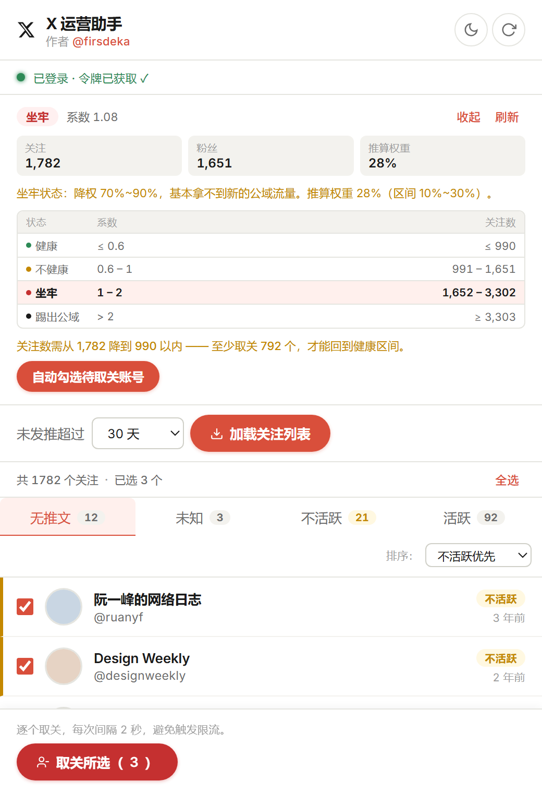

# X 运营助手

> 先看账号健康度，再决定清净谁 —— 不需要 API Key，也不需要任何付费服务。



Chrome / Edge 扩展（Manifest V3）：检测自己账号的健康度（关注数 ÷ 粉丝数）→ 加载你关注的人 → 估算每人最后一次发推时间 → 批量取关。

---

## 作者 · 致谢

| | |
|---|---|
| **作者** | [@fatmanplaydiec1](https://x.com/fatmanplaydiec1) —— **求关注~** |
| **基于** | [K4nes/X-Unfollower](https://github.com/K4nes/X-Unfollower) 改动 |
| **鸣谢** | [@firsdeka](https://x.com/firsdeka)（上游 X-Unfollower 原作者） |

本项目是在原版基础上做的**中文化 + 健康度扩展**，核心的「加载关注列表 / 估算活跃度 / 逐个取关」逻辑沿用上游实现。

## 相比原版做了什么

- **全量中文化**：界面、提示、错误信息全部中文；调试日志保留英文便于排查。
- **新增「账号健康度」**：算系数、判档位、推算权重，并按当前粉丝数**反推关注数的安全区间**。
- **按健康线自动勾选**：算出「至少取关多少个」，按「无推文 → 无数据 → 最久没发推」的顺序自动勾到健康线。
- **健康度只读页面、不调接口**：早期版本试过 X 的内部接口，`users/show.json` 被下线后返回 `404 code 34`，`verify_credentials` 也经常 `401`。现在直接读你自己主页上的「正在关注 / 关注者」，不碰这些随时会失效的接口。
- **长任务看门狗**：抓列表 / 查活跃度 / 取关本来没有超时，链路断掉会一直转圈；现在 20 秒没有进度就判定断开并恢复按钮。
- **扩展上下文失效提示**：扩展重载后侧边栏会失去 chrome 上下文，此时刷新 x.com 是没用的，会明确提示「关闭侧边栏后重新打开」。

## 安装（未打包加载）

暂未上架 Chrome 应用商店，只能以开发者模式加载。

1. 打开 `chrome://extensions`（Edge 为 `edge://extensions`）。
2. 打开右上角的 **开发者模式**。
3. 点击 **加载已解压的扩展程序**，选择本仓库根目录（含 `manifest.json` 的那一层）。
4. 想固定在工具栏的话，在扩展菜单里把「**X 运营助手**」钉住。

## 快速上手

1. 打开 [x.com](https://x.com) 并登录，随便刷一下让页面加载完整。
2. 点击扩展图标，右侧 **侧边栏** 会打开，顶部直接显示健康度。
3. 选「未发推超过」的时间阈值，点击 **加载关注列表**。
4. 用标签页筛选（**无推文 / 未知 / 不活跃 / 活跃**）、**排序**、勾选账号，然后点击 **取关所选**。
   取关是逐个执行的，中间有间隔；中途可点 **停止**，已抓取的数据会保留。

## 账号健康度

**系数 = 关注数 ÷ 粉丝数**

| 系数 | 状态 | 权重 / 流量 |
|------|------|-------------|
| ≤ 0.6 | 健康 | 权重 100%，正常推荐 |
| 0.6 ~ 1 | 不健康 | 权重下降 30%~70%，推流变慢 |
| 1 ~ 2 | 坐牢 | 降权 70%~90%，基本没有新的公域流量 |
| > 2 | 踢出公域 | 不再进入公域推荐流量池 |

边界归类：系数正好 0.6 算健康、正好 1 算不健康、正好 2 算坐牢。

### 反推「关注数」的安全区间

粉丝数不变的前提下（记粉丝数为 F，当前关注数为 N），把上面四条改写成关注数的区间：

| 状态 | 系数条件 | 关注数区间 |
|------|----------|------------|
| 健康 | N ÷ F ≤ 0.6 | ≤ ⌊0.6F⌋ |
| 不健康 | 0.6 < N ÷ F ≤ 1 | ⌊0.6F⌋+1 ~ ⌊F⌋ |
| 坐牢 | 1 < N ÷ F ≤ 2 | ⌊F⌋+1 ~ ⌊2F⌋ |
| 踢出公域 | N ÷ F > 2 | ≥ ⌊2F⌋+1 |

**要回到健康区间，至少需要取关：N − ⌊0.6F⌋ 个。**

举例（粉丝 900）：健康 ≤ 540；不健康 541~900；坐牢 901~1,800；踢出公域 ≥ 1,801。
若当前关注 1,280（系数 1.42，坐牢，推算权重约 22%），需要取关 **740** 个才能回到健康线。

侧边栏会把这张表直接画出来并高亮当前档位，还会给出「至少取关多少个」的建议。
点 **自动勾选待取关账号** 会按优先级勾选到健康线，再点 **取关所选** 执行。

> 「推算权重」是按档位区间线性插值出来的估算值，仅用于直观参考，并非 X 官方公布的公式。

### 关注数 / 粉丝数从哪来

**只读页面，不调用任何 X 接口。** 这两个数字本来就印在你自己的主页上，而 X 的内部接口随时会 `401` / `404`。

1. **当前页就是你的主页** → 直接读 DOM，零请求、瞬时出结果。
2. **不在主页也没关系** → 在后台新开一个标签页打开 `x.com/<你的用户名>`，
   轮询读到「正在关注 / 关注者」的数字后**立刻把标签页关掉**。

> 用户名从左侧导航的「个人资料」链接里读；如果你正停在别人主页，绝不会把别人的数字当成你的
> （必须同时找到 `a[href="/你的handle/following"]` 和关注者链接，对不上就直接放弃）。
>
> 读到的数字会缓存 30 分钟：这期间打开侧边栏直接显示，不会再去开标签页；点卡片上的「刷新」才重新读。

读不到时卡片会展开两个输入框，按主页上的数字手填一次即可 —— 会记住；手动模式下取关成功后关注数会自动扣减。

取数由侧边栏通过 `chrome.scripting.executeScript` 直接在你自己的 x.com 页面里执行，
结果按返回值拿，不经过 `popup ⇄ background ⇄ bridge.js ⇄ content.js` 那条消息通道，也不发任何网络请求。

## 代码结构

| 部分 | 作用 |
|------|------|
| `src/content/content.js`（MAIN world，运行在 x.com） | 读取 Cookie 与内部接口：关注列表、时间线、取关、限流等待 |
| `src/content/bridge.js`（隔离世界） | 转发 `window.postMessage` ↔ 扩展运行时 |
| `src/background/background.js` | 侧边栏、存储、选标签页、消息路由 |
| `popup/popup.js` | 侧边栏界面逻辑 |
| `popup/health.js` | 健康度算法（纯函数，可单独运行验证） |
| `popup/xprobe.js` | 读页面：绕开消息通道，由侧边栏直接注入页面取数 |

```
列表/取关：侧边栏 ──► background.js ──► bridge.js ──► content.js（x.com 标签页）
健康度   ：侧边栏 ──► chrome.scripting.executeScript(world: MAIN) ──► 直接读 DOM 返回值
```

**用到的接口（v1.1 REST）：** 只有抓关注列表和取关会用到 —— `friends/list`、`statuses/user_timeline`、`friendships/destroy`。
**健康度不调用任何接口**。
鉴权：CSRF Cookie + bearer token（从页面脚本/请求流量中提取，兜底用 X 自身包里的公开 token）。

## 限流说明

脚本会自动处理限流（暂停 + 倒计时后继续）。活跃度检查以 **5 个并发** 请求运行，并会根据限流剩余额度自适应降速。

| 操作 | 大致上限 |
|------|----------|
| 获取关注列表 | 约 15 页（≈3000 个账号）/ 15 分钟 |
| 活跃度检查 | 同时约 5 个请求；900 次 / 15 分钟窗口；接近上限自动暂停 |
| 取关 | 每 2 秒 1 个；单日量过大会有被 X 风控标记的风险 |

关注量大时需要几分钟；中途取消的话，已抓到的部分会留在本地存储里。

## 隐私与安全

- **没有额外服务器** —— 流量只在你浏览器与 `x.com`（及 `twitter.com`）之间。
- 令牌取自你自己的登录会话，和网站本身一致。
- 数据只存在 **`chrome.storage.local`**（申请了 `unlimitedStorage` 以容纳大关注列表）。
- 调试日志会对敏感字段打码。
- 没有内联事件处理器，DOM 绑定全部走 `addEventListener`。

## 常见问题

**「插件已更新或重新加载 —— 请关闭侧边栏后重新打开」**
扩展被重新加载 / 更新后，已经开着的侧边栏页面会失去 chrome 上下文，此时刷新 x.com 页面是**没用**的。
关闭侧边栏，再点扩展图标重新打开即可。

**「后台链路无响应」**
抓列表时出现，说明侧边栏与页面脚本之间的通道断了：关掉侧边栏重开，或刷新 x.com 页面后再试。

**健康度显示「无法检测」**
说明页面上没读到数字。手动填一次即可；或者点左侧「个人资料」进主页后点「刷新」。

## 注意事项

- 浏览器里必须有一个打开的 **x.com 标签页**。
- 健康度读的是**你当前登录的账号**；切换账号后点「刷新」重新读取。
- **保护推文** 的账号无法检查时间线 → 归入 **未知**，不会被自动勾选。
- **零推文** 的账号 → 归入 **无推文**（与不活跃/活跃分开统计）。
- **粉丝数为 0** 时系数按无穷大处理（直接判为踢出公域），避免除零得 0 的误判。
- **Chrome / Edge：** 支持 · **Firefox / Safari：** 不支持（依赖 MV3 侧边栏）。
- 取关是对 X 的自动化操作，频率过高可能被风控，**请自行评估风险**。

## 许可

上游 [K4nes/X-Unfollower](https://github.com/K4nes/X-Unfollower) 未声明开源许可证，本项目作为其非商业的个人修改版公开，保留原作者署名。
如果你是原作者并希望下架本项目，请通过 [@fatmanplaydiec1](https://x.com/fatmanplaydiec1) 联系。

---

*原生 JS、Manifest V3、无构建依赖。*
